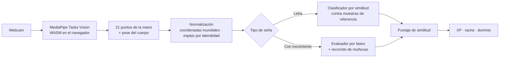

# Amanos

**Web app para aprender Lengua de Señas Salvadoreña (LESSA) con corrección por cámara.**
Practicás una seña frente a la webcam y la app te dice qué tan parecida es a la referencia, todo
dentro del navegador, sin mandar video a ningún servidor.


<!-- TODO: link a la demo en vivo (Vercel) -->
<!-- TODO: GIF de la práctica con cámara reconociendo una seña, en docs/img/ -->

---

## Qué hace

- **Lecciones por unidades**: letras (A, B, C, I, S), saludos (hola, buenos días, buenas tardes,
  adiós), presentación (tú) y cortesía (gracias).
- **Práctica con cámara**: MediaPipe detecta mano y cuerpo en tiempo real y la app compara tu
  movimiento contra referencias grabadas del equipo.
- **Avatar 3D** que muestra cómo se hace cada seña, animado con three.js y un modelo VRM.
- **Gamificación**: XP, racha diaria, meta del día y dominio por seña.
- **Login con Google**, plan premium (mock, sin cobro real) y **panel admin** para activar o
  desactivar la evaluación de cada seña.
- **Funciona sin backend**: sin API configurada todo vive en `localStorage`, así la demo nunca
  depende de internet. Con API, el progreso se sincroniza y si el servidor cae la app sigue en
  modo local.
- Modo oscuro y diseño pensado para móvil.

---

## Cómo funciona el reconocimiento



- **Letras**: se normalizan los 21 puntos de la mano y se comparan contra todas las clases. El
  resultado tiene que ganar con margen claro sobre la segunda opción y sostenerse un segundo
  continuo; un corte de más de 250 ms reinicia el intento.
- **Señas con movimiento** (gracias, buenos días, adiós...): evaluadores por fases que revisan
  postura de manos, posición de brazos y el recorrido de las muñecas, con versión espejada para
  zurdos.
- El porcentaje es **similitud**, no precisión medida. La validación con señantes nativos de LESSA
  sigue pendiente y está documentada como tal.

---

## Arquitectura

| Capa | Tecnologías |
|---|---|
| Frontend | Next.js 14 (App Router), React 18, TypeScript, Tailwind |
| Visión por computadora | MediaPipe Tasks Vision (WASM local, con respaldo por CDN) |
| Avatar | three.js, three-vrm, Kalidokit |
| Backend | NestJS, TypeORM, Swagger |
| Base de datos | SQLite (sql.js) en local, PostgreSQL en Supabase con RLS en producción |
| Auth | Google ID token verificado en el servidor |
| Pruebas | `node:test` en el front (reconocimiento, gamificación, evaluadores) y Jest + e2e en la API |

Detalles que valen la pena:

- **Una sola fuente de verdad para la gamificación**: las reglas de XP y racha viven en
  `lib/gamification.ts` y se copian a la API. Un test falla si las dos versiones dejan de ser
  idénticas.
- **Fechas en `America/El_Salvador`**, no en UTC, para que la racha se corte a medianoche local.
- **RLS activo sin políticas** en Supabase: solo la API puede leer y escribir, la API REST pública
  de Supabase no ve nada.
- El video de la cámara **nunca sale del dispositivo**; a la API solo llega el puntaje.

---

## Correr el proyecto

```bash
npm install            # también descarga el modelo de MediaPipe
npm run dev            # http://localhost:3000
npm test               # pruebas de reconocimiento y gamificación
```

Backend opcional:

```bash
cd api && cp .env.example .env && npm install
npm run build && npm start   # http://localhost:4000, Swagger en /docs
npm test
```

La guía completa (variables de entorno, cómo grabar referencias, endpoints, límites conocidos)
está en [`docs/DESARROLLO.md`](docs/DESARROLLO.md).

---

## Documentación

| Documento | Contenido |
|---|---|
| [`docs/DESARROLLO.md`](docs/DESARROLLO.md) | Setup, modo local vs API, referencias y limitaciones |
| [`docs/obsidian/`](docs/obsidian) | Historias de usuario, requerimientos, fases y módulos |
| [`references/`](references) | Notas de evaluación de cámara y revisión de poses |

---

## Autor

**Christian Renderos** ([@ChristianRende22](https://github.com/ChristianRende22)), desarrollador principal.
